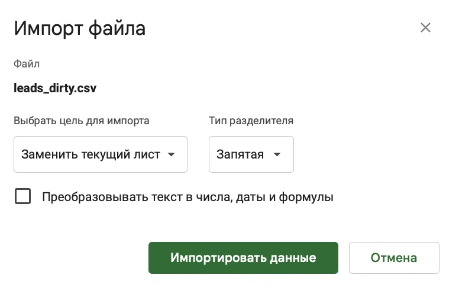
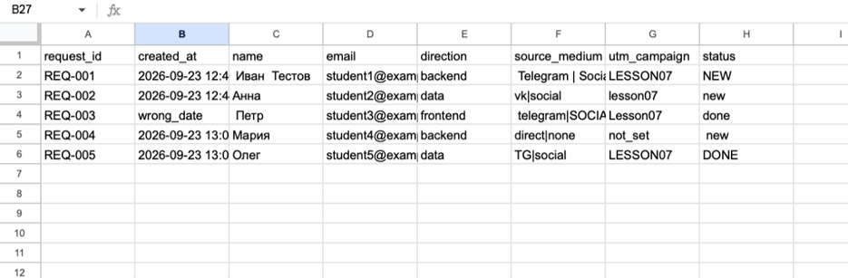
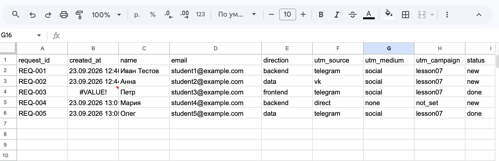
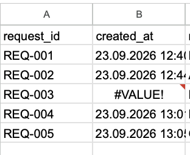
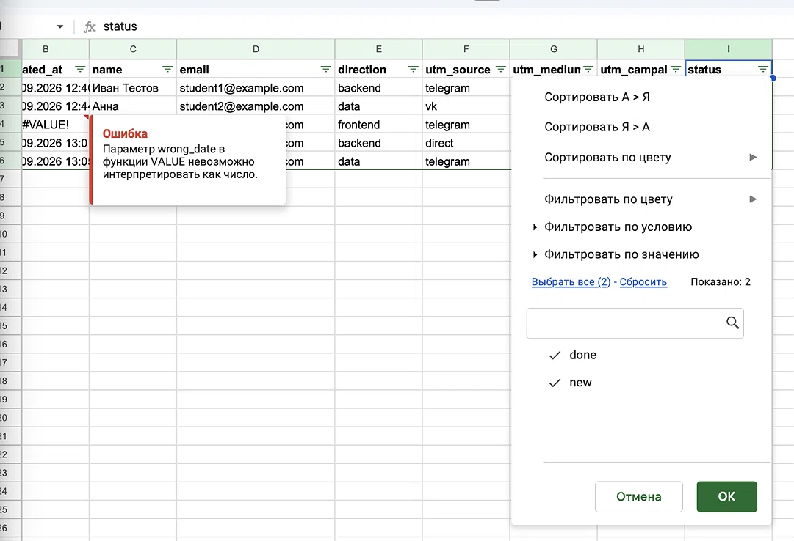
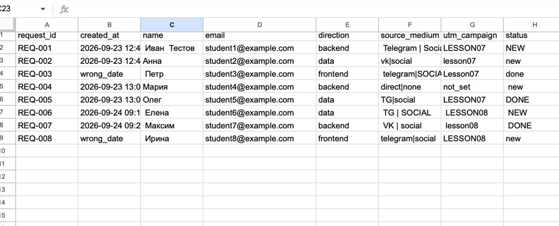
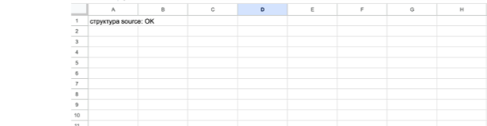

# Домашняя работа № 6 · Подготовка данных в Google Таблицах

**Дисциплина:** ОП.03 «Информационные технологии»

| Поле | Значение |
|---|---|
| Фамилия, имя, отчество |  Суетнова Арина Евгеньевна|
| Группа |  11/1 РПО 26/1 |
| Номер работы | 6 |
| Тема работы | Повторяемая очистка выгрузки заявок в Google Таблицах |
| Дата сдачи | 20.10 |
| Ветка | `hw-06` |

---

## 1. Импорт

Я создала таблицу `leads_cleaning` и импортировал `leads_dirty.csv` на лист
`source` с целью «Заменить текущий лист» и снятым флажком «Преобразовывать
текст в числа, даты и формулы». Данные на `source` остались такими,
как в файле, и я их не редактировал.

## 2. Правила

На листе `leads_clean` девять заголовков, и в каждом столбце одна формула
ARRAYFORMULA во второй строке. Формулы убирают лишние пробелы, делят
`source_medium` на источник и канал, приводят метки и статус к нижнему
регистру и заменяют `tg` на `telegram`.

## 3. Ошибка и проверка значений

В строке `REQ-003` дата записана как `wrong_date`, поэтому в `created_at`
стоит `#VALUE!`. Я оставил ошибку видимой, чтобы не потерять неверную
запись. В фильтре `status` после очистки только `done` и `new`.

)

## 4. Вторая выгрузка

Я импортировал `leads_dirty_v2.csv` на тот же лист `source`. Формулы
не менял: в `leads_clean` стало 8 строк вместо 5, ошибочные даты видны
у `REQ-003` и `REQ-008`. Строка `REQ-006` очистилась в
Елена / telegram / social / lesson08 / new. Результат скачан и лежит
в этой папке как `leads_clean.csv`.

## 5. Проверка структуры

На листе `check` формула сравнивает заголовки `source` с ожидаемыми
и показывает «структура source: OK». Если столбцы в CSV переставят,
она покажет «СТОП: изменились столбцы source».

---
