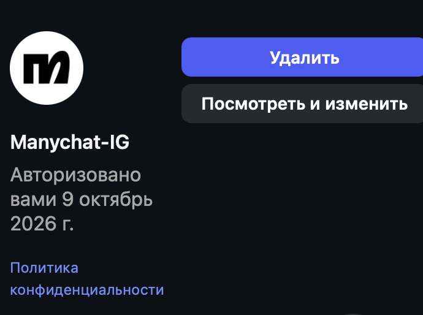
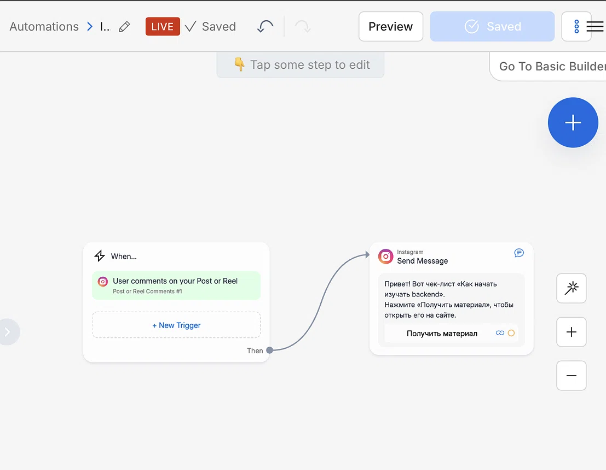
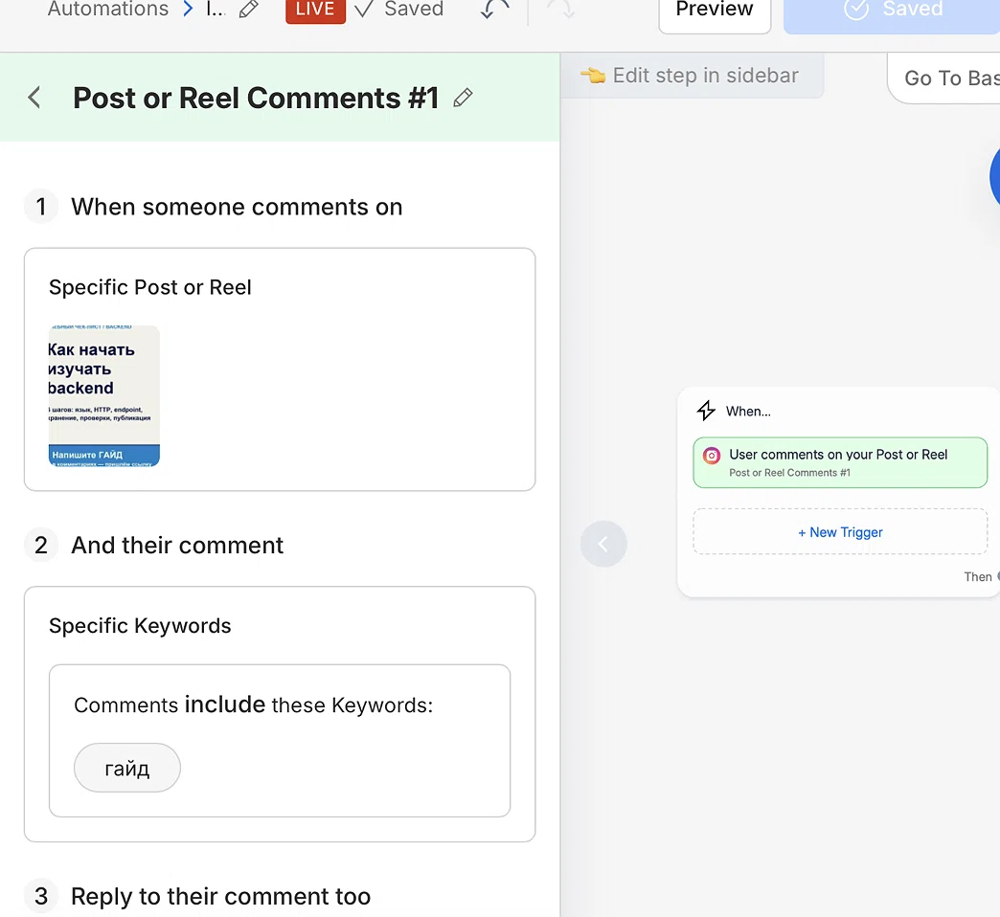
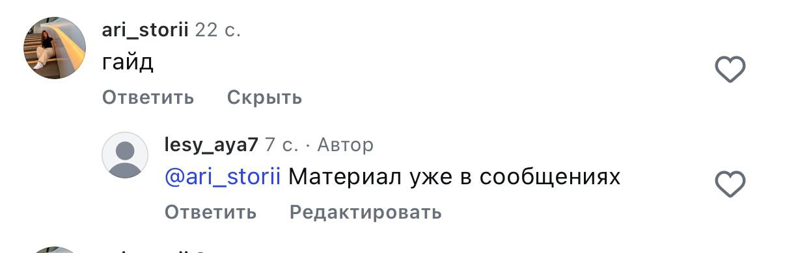
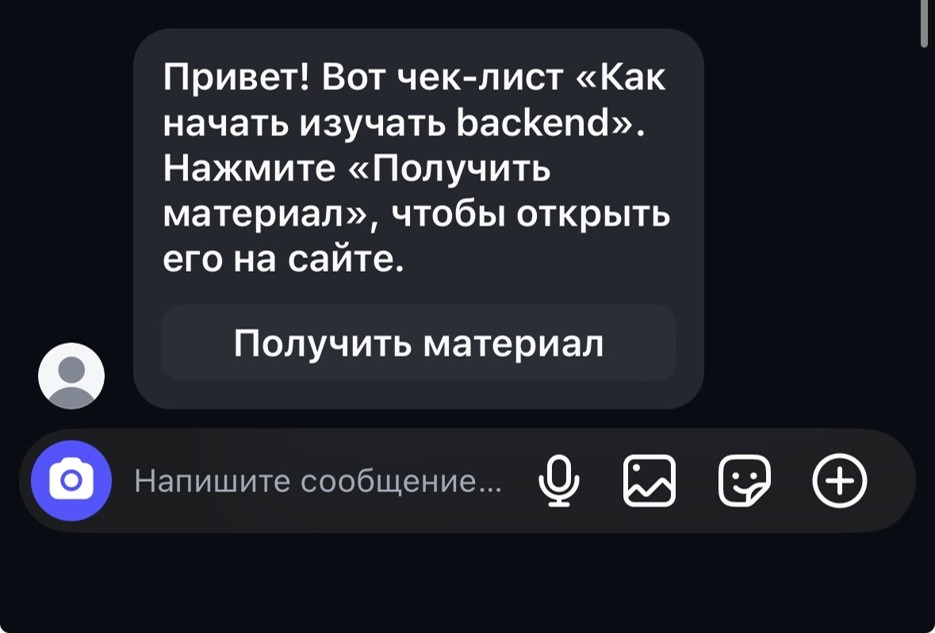
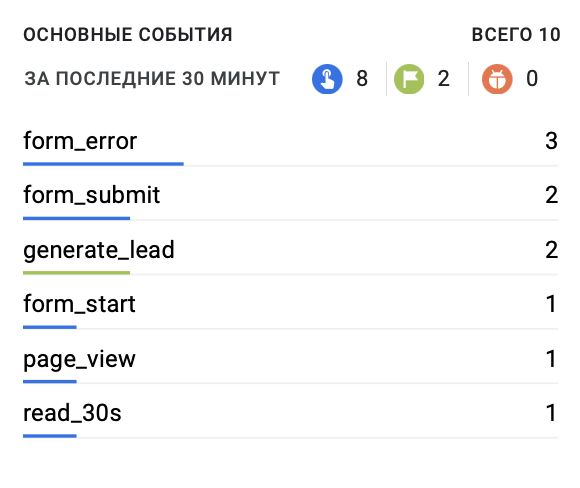
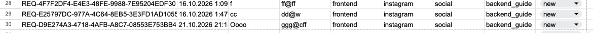

# Домашняя работа № 7 · Instagram → ManyChat → заявка

**Дисциплина:** ОП.03 «Информационные технологии»

| Поле | Значение |
|---|---|
| Фамилия, имя, отчество | Суетнова Арина Евгеньевна |
| Группа | 11/1 РПО 26/1 |
| Номер работы | 7 |
| Тема работы | Автоворонка из Instagram: комментарий → сообщение → сайт → заявка |
| Дата сдачи | 22.10|
| Ветка | `main` |

---

## 1. Подключение и automation

Я перевёл учебный аккаунт Instagram в профессиональный и подключил его
к ManyChat на тарифе Free. Собрал automation: триггер на комментарий под
выбранной публикацией, ключевое слово `ГАЙД`, публичный ответ, личное
сообщение и кнопка «Получить материал» со ссылкой с UTM. Automation
включена в режиме Live.

| Мои данные | Значение |
|---|---|
| Учебный аккаунт Instagram | lesy_aya7 |
| Ссылка на учебную публикацию | (https://www.instagram.com/p/DeOy1AtDN2B/?srtk=OXRyMG9rdjIyb3Bz) |
| Публичный адрес сайта | https://ga4-analytics-lab-alpha.vercel.app |
| Measurement ID (`G-…`) | G-SQ3VP4KR84 |

## 2. Тест цепочки

Со второго аккаунта ari_storii я оставил комментарий `ГАЙД`. Под ним появился
автоматический ответ, а в Direct пришло сообщение с кнопкой. Кнопка
открыла `guide.html` с метками в адресе, оттуда я перешёл к форме
и отправил тестовую заявку.

## 3. Результат

В GA4 пришли `page_view` со страницы `guide.html` и `generate_lead`.
В листе `leads` появилась строка с метками `instagram` / `social` /
`backend_guide` и статусом `new`.

---
ИИ: не использовала
