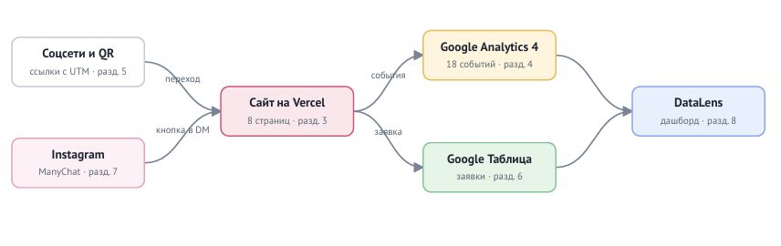

# Сахарный цех — сайт и сквозная аналитика заявок

*Курсовая работа по дисциплине ОП.03 «Информационные технологии», ТЗ № Т3-12/2026.*

*Исполнитель: [Суетнова Арина]*

*Группа [11/1 рпо 26/1].*

*Сайт кондитерской «Сахарный цех»: каждый посетитель приходит с меткой источника, каждая заявка попадает в Google Таблицу, а руководитель видит на дашборде DataLens, какой канал приводит клиентов.*



## Ссылки

| **Что** | **Ссылка** |
|---|---|
| Сайт на Vercel | https://tz-12-konditerskaya-saharnyy-ceh.vercel.app |
| Таблица заявок | https://docs.google.com/spreadsheets/d/1DOBYjb0NQLYJfS_Y7XwncTWQpdZttf65RAA32RalpPI/edit |
| Дашборд DataLens | https://datalens.ru/bkqfrekoywfcu-saharnyy-ceh |
| Instagram и Reel с автоответом | https://www.instagram.com/p/DffKReXslEp/ |
| ВКонтакте · Telegram · YouTube | https://...utm_source=instagram... · https://...utm_source=telegram... · https://...utm_source=youtube... |
| Описание работы | [docs/opisanie.md](docs/opisanie.md) |
| Презентация к защите | [presentation/zashchita.pdf](presentation/zashchita.pdf) |

Ресурс GA4: `G-5FS35RKVFQ`. Доступ Viewer к ресурсу GA4 выдан: e-mail Заказчика (Пестов Артём Валерьевич, `manager@sugar-ceh.example`).

## Что сделано

| **Часть** | **Результат** |
|---|---|
| Сайт | 8 страниц + 404, статический HTML/CSS/JS, Vercel, Lighthouse: [P] / [A] / [S] |
| GA4 | 18 событий, 7 пользовательских параметров, ключевые: `generate_lead`, `contact_click`, `messenger_click` |
| UTM | 12 ссылок в реестре, публикации в 4 соцсетях, QR на афише |
| Заявки | форма → Apps Script → лист `leads`, проверка полей и повторов |
| Instagram | ManyChat, две ветки: `ГОСТИ` и `ДЕТИ` |
| Отчёты | Reports, Explore, воронка, путь, дашборд DataLens из трёх вкладок |

## Технологии

HTML, CSS, JavaScript · Google Analytics 4 · Google Таблицы и Apps Script · ManyChat · Yandex DataLens · GitHub и Vercel.
Сайт создан с помощью [ChatGPT / Claude / v0 — оставь свой инструмент] (запросы — в [docs/prompts.md](docs/prompts.md)).

## Структура

```text
index.html … 404.html     страницы сайта
css/                      стили
js/analytics.js           все события GA4
js/form.js                отправка формы
apps-script/Code.gs       приёмник заявок
docs/                     описание, схема, события, UTM, записка, промпты
screens/                  кадры-доказательства по разделам ТЗ
presentation/             презентация к защите
